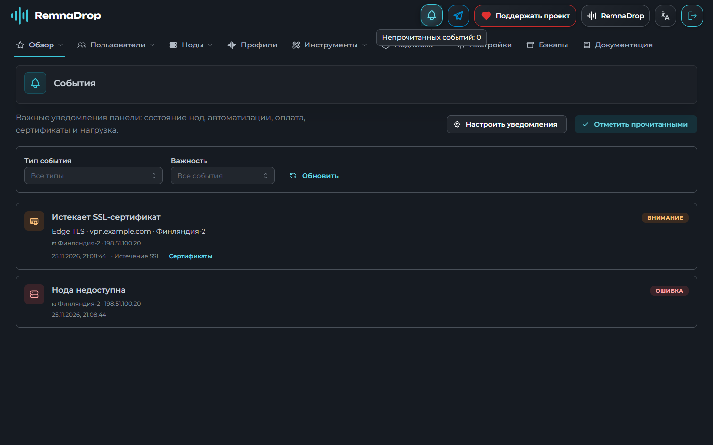
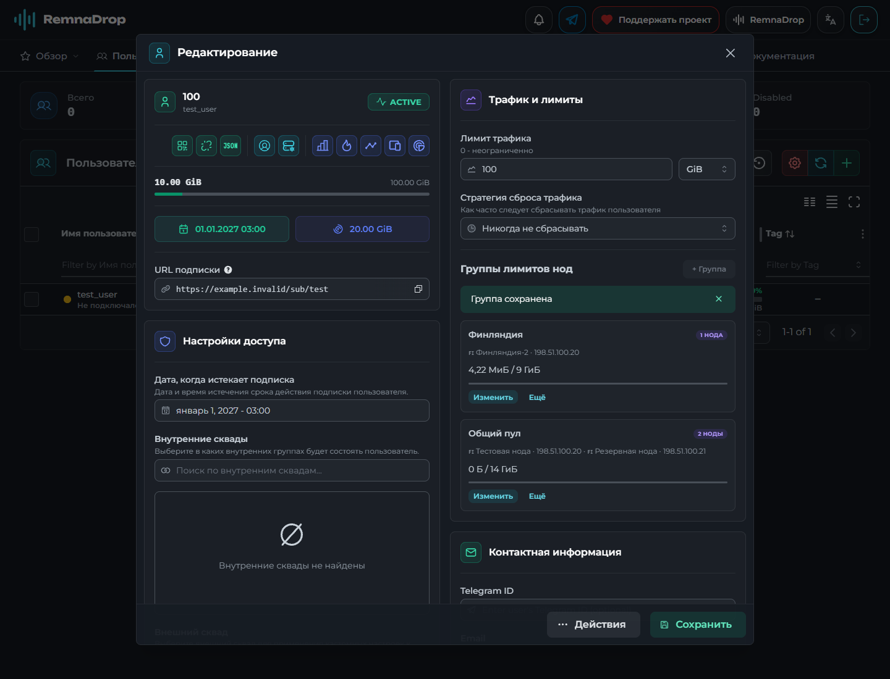
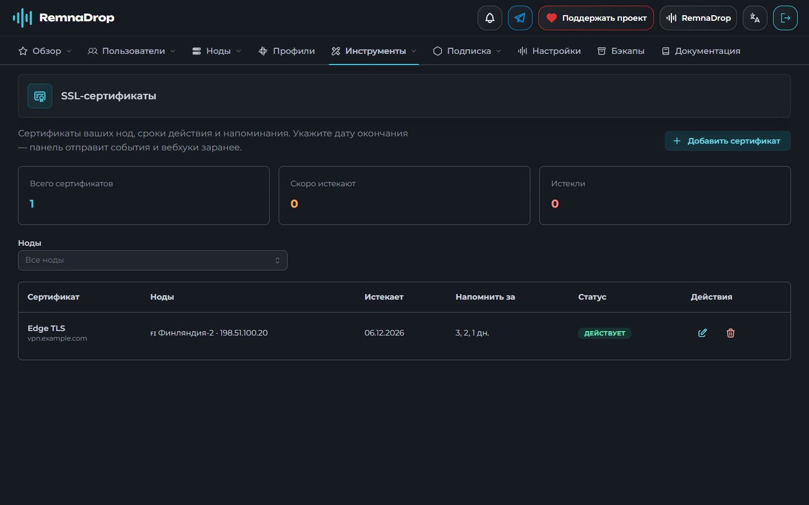
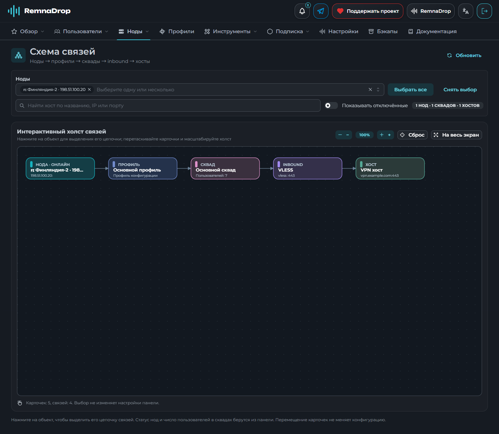
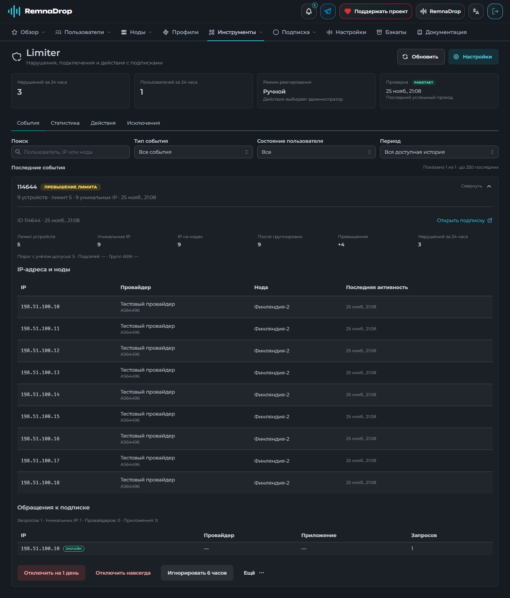
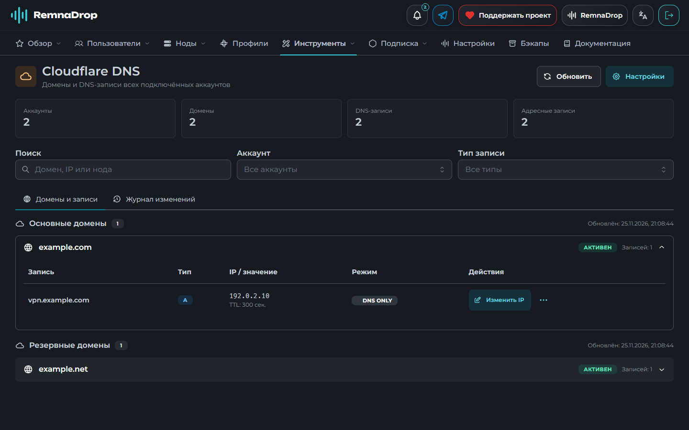
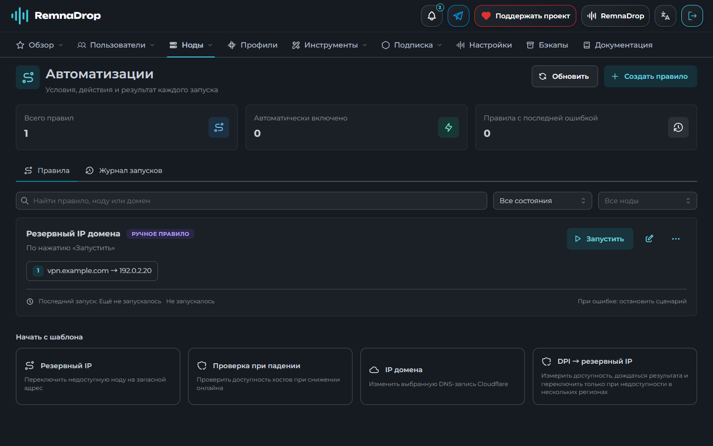

# RemnaDrop

Форк панели **Remnawave 2.8.1** с инструментами для управления нодами, квотами и событиями. Исходные версии backend и frontend зафиксированы в [`upstream.lock.json`](upstream.lock.json). Это исходный код панели: установка поверх работающей Remnawave описана ниже, а простое клонирование репозитория не заменяет запущенный контейнер.


## Что добавлено в форке

Подробный перечень изменений: [CHANGELOG.md](CHANGELOG.md).

| Раздел | Возможности |
| --- | --- |
| Пользователи и трафик | Несколько групп квот у пользователя: отдельный лимит для одной ноды или общий лимит для нескольких; пороги предупреждений, сброс и блокировка доступа после исчерпания. Квоты доступны при создании пользователя через API. Переменные трафика для названий хостов. |
| События и уведомления | Журнал падений и восстановления нод, входов в панель, автоматизаций, оплаты, SSL и нагрузки. Счётчик непрочитанного, уведомления в открытом браузере с выбором типов и исключениями по нодам. |
| Мониторинг и связи | История нескольких метрик и нод на графике, выбор периода и часового пояса, экспорт CSV. Интерактивная схема «нода → профиль → сквад → inbound → хост». |
| SSL и автоматизации | Учёт сертификатов по нодам и напоминания за выбранное число дней. Правила по состоянию нод, DPI, IP и DNS с предварительным просмотром и журналом запусков. |
| Инструменты | Встроенный Limiter, DPI Checker с настройкой прокси, Cloudflare DNS с несколькими аккаунтами, торрент-блокер с доступной информацией об устройстве. |
| Эксплуатация | Резервное копирование, проверка обновления, сборка нового образа, тестовое восстановление БД и команда отката. Документация API и штатные подписанные вебхуки Remnawave. |

Подробности: [квоты](QUOTAS.md) · [события и SSL](EVENTS_AND_SSL.md) · [мониторинг](MONITORING.md) · [автоматизации](NODE_OPERATIONS.md) · [Limiter и Cloudflare](INTEGRATIONS_LIMITER_CLOUDFLARE.md) · [резервные копии](BACKUPS.md).

## Скриншоты

| Журнал событий | Группы квот в редакторе пользователя |
| --- | --- |
|  |  |

| Мониторинг SSL | Схема связей |
| --- | --- |
|  |  |

| Limiter | Cloudflare DNS |
| --- | --- |
|  |  |



## Требования к серверу

Для **работающей панели** ориентиром служат [официальные требования Remnawave](https://docs.rw/install/requirements/): минимум **2 ГБ ОЗУ, 2 vCPU и 20 ГБ диска**; рекомендуется **4 ГБ ОЗУ и 4 vCPU**. Нода устанавливается отдельно и требует минимум 1 ГБ ОЗУ и 1 vCPU; нагрузка Xray зависит от числа подключений.

Для **сборки обновления RemnaDrop на том же VPS** рекомендуем **4 ГБ ОЗУ и 2 ГБ swap**. Диск от **40 ГБ** подходит лишь при хранении архивов резервных копий отдельно; для локального хранения прибавьте их объём. Обновлятор требует не менее **12 ГиБ свободного места перед сборкой**, затем рассчитывает дополнительный резерв по размерам БД и, только если потребуется экспорт старого контейнера, его файловой системы. На сервере с 2–3 ГБ ОЗУ понадобится swap или сборка образа на другой машине.

Нужны Linux (рекомендуются Ubuntu или Debian), Docker Engine с Compose v2, Git, Python 3 и действующая установка **Remnawave 2.8.1** с контейнерами `remnawave`, `remnawave-db`, `remnawave-redis`. Узлы и reverse proxy можно оставить как есть.

## Установка поверх Remnawave 2.8.1

На сервере панели:

```bash
sudo git clone https://github.com/ap1w1/remnadrop.git /opt/remnadrop-git
sudo install -m 755 /opt/remnadrop-git/scripts/remnadrop-cli.sh /usr/local/bin/remnadrop
sudo remnadrop check
sudo remnadrop update
sudo remnadrop status
```

`check` проверяет совместимость без перезапуска панели. `update` собирает образ, делает резервную копию PostgreSQL и конфигурации, проверяет восстановление БД, применяет миграции и проверяет здоровье нового контейнера. В конце выводятся путь к резервной копии и команда отката. Сохраняйте этот вывод до проверки входа в панель, подписок и подключения нод.

**Новый сервер:** сначала установите оригинальную Remnawave **2.8.1** с PostgreSQL и Redis; данный установщик предназначен для перехода с уже работающей версии 2.8.1. Использовать текущую инструкцию установки Remnawave для более новой версии и затем запускать этот мигратор нельзя. Пошаговые проверки, обновление существующего форка и откат описаны в [INSTALL.md](INSTALL.md). Для обновления уже установленного RemnaDrop достаточно `sudo remnadrop update`.

После смены публичной истории Git старому клону на VPS понадобится однократная синхронизация; [команды приведены в инструкции](INSTALL.md#если-серверный-клон-создан-до-очистки-истории-git).

## API и вебхуки

Маршруты форка и схемы запросов доступны в разделе **Документация API** панели. Примеры групп квот и событий находятся в [QUOTAS.md](QUOTAS.md). События форка отправляются через штатные `WEBHOOK_ENABLED`, `WEBHOOK_URL`, `WEBHOOK_SECRET_HEADER`, с заголовками `X-Remnawave-Signature` и `X-Remnawave-Timestamp`. Отдельные ключи для вебхуков квот не требуются.


Исходные проекты Remnawave имеют лицензию **AGPL-3.0-only**; её текст находится в [LICENSE](LICENSE). Встроенный исходный код Limiter сохраняет собственный файл лицензии в [`integrations/limiter-runtime/vendor/LICENSE`](integrations/limiter-runtime/vendor/LICENSE). Форк не связан с официальной командой Remnawave.
